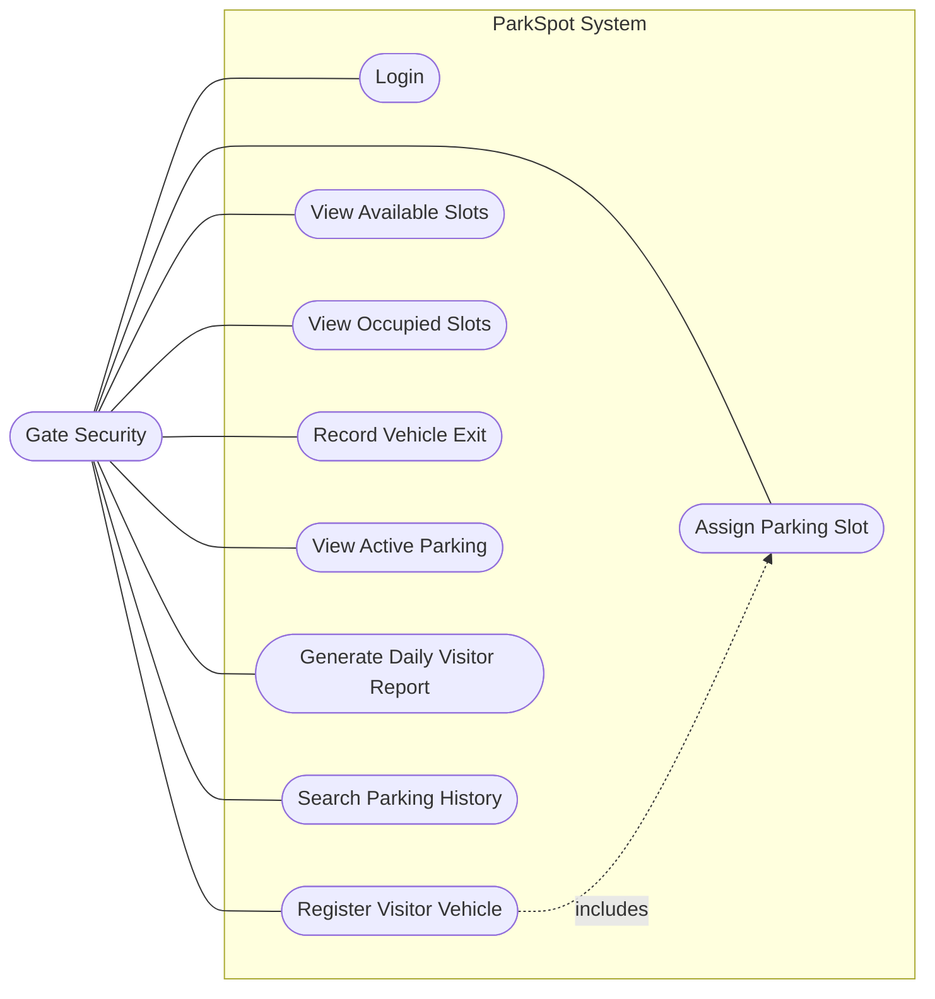
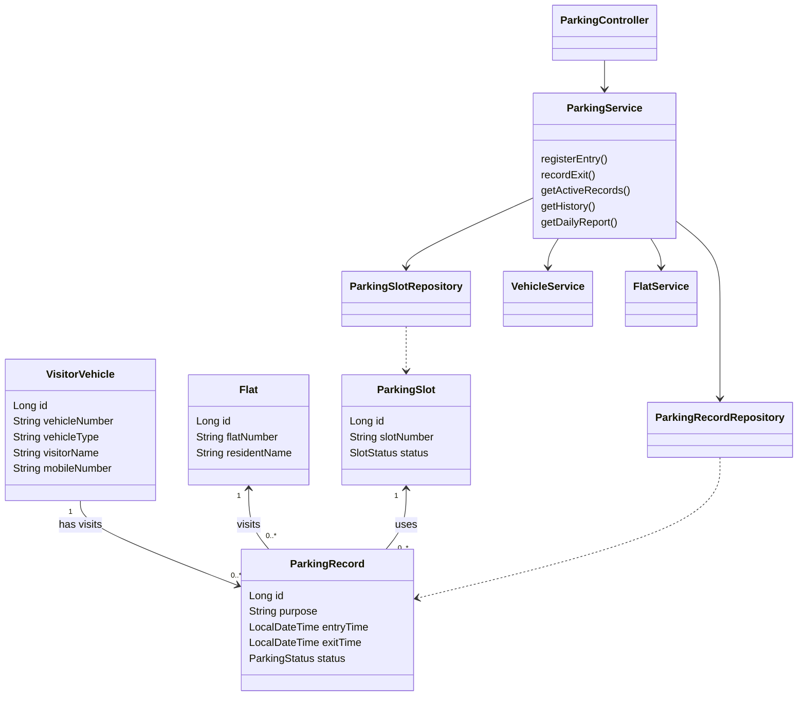
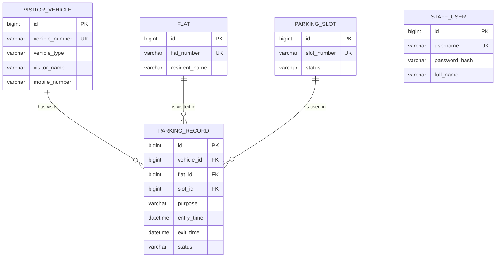
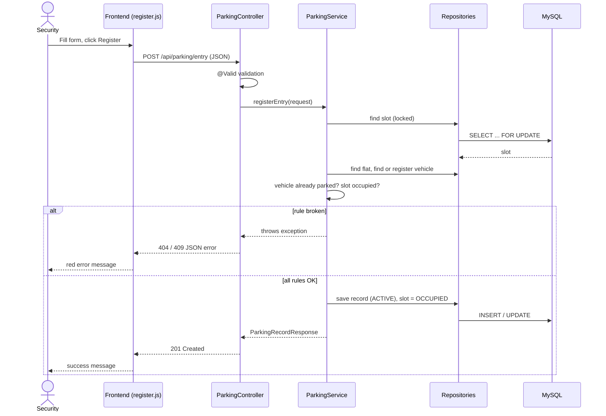
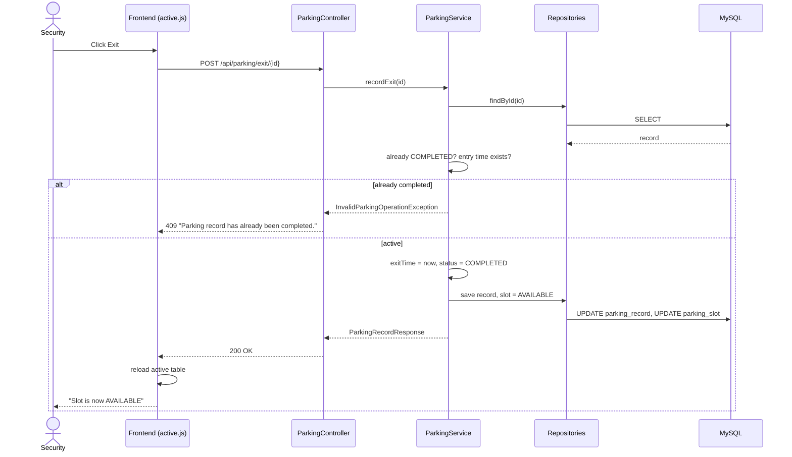

# UML diagrams (Mermaid)

View them by pasting each block into https://mermaid.live (export PNG/SVG for the report), or open this file in VS Code / GitHub.

## 1. Use case diagram

## 2. Class diagram

## 3. ER diagram

## 4. Sequence diagram – vehicle entry

## 5. Sequence diagram – vehicle exit

